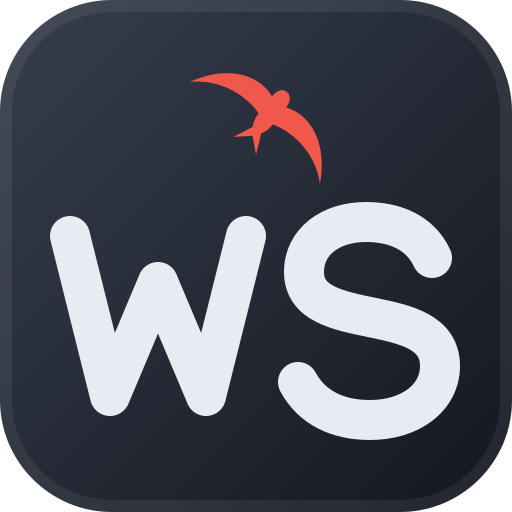

# WatchSwifty

[](https://github.com/PaddXy95/watchswifty/actions/workflows/docker.yml)
[](https://github.com/PaddXy95/watchswifty/releases)

[](https://www.swift.org)
[](https://vapor.codes)

Selbst gehosteter Serien- und Film-Tracker in Swift (Vapor 4, Fluent/SQLite, Elementary + htmx).

- **Weiterschauen:** eine Karte pro Serie mit der nächsten Folge (Serien der letzten 3 Monate)
- **Netflix-Import:** Wiedergabeaktivität als CSV hochladen, wird automatisch TMDB zugeordnet
- **Manuell:** Serien/Filme suchen, Folgen abhaken (mit Datum und Dienst), bewerten (1–10),
  private Kommentare zu Serie, Staffel und Film
- **Verlauf** und **Bibliothek**, Klappentext und Links zu TMDB, IMDb, Rotten Tomatoes, SeriesGraph
- **Statistik:** gesehene Filme, Serien, Folgen und verbrachte Zeit – insgesamt, pro Jahr/Monat und nach Bewertung
- **Mehrere Benutzer** mit getrennten Daten; der Admin legt Konten an oder lädt per Mail ein
- **E-Mail (optional):** Einladungen und „Passwort vergessen“ über einen SMTP-Server, z. B. [SwiftyRelay](https://github.com/PaddXy95/SwiftyRelay)

Repository: https://github.com/PaddXy95/watchswifty

Film- und Seriendaten stammen von [TMDB](https://www.themoviedb.org). Diese Anwendung verwendet TMDB und die
TMDB-APIs, ist aber nicht von TMDB unterstützt, zertifiziert oder anderweitig genehmigt. Gemäß den TMDB-Bedingungen
werden zwischengespeicherte Daten spätestens nach 60 Tagen mit dem Token eines Benutzers, der den Titel nutzt, neu
geholt; nicht mehr genutzte Titel werden gelöscht.

---

## Schnellstart mit Docker Compose

Die GitHub Action baut bei jedem Push auf `main` das Image `ghcr.io/paddxy95/watchswifty:latest`.

1. Auf dem Server einen Ordner anlegen (z. B. `~/watchswifty`) und `docker-compose.yml` sowie `.env.example`
   aus diesem Repository hineinkopieren; `.env.example` in `.env` umbenennen.
2. In der `.env` mindestens `TOKEN_KEY` (Ausgabe von `openssl rand -base64 32`) und `ADMIN_PASSWORD` eintragen
   und den Schlüssel zusätzlich sicher aufbewahren (siehe [TMDB-Tokens verschlüsselt](#tmdb-tokens-verschlüsselt)).
   Die Datei nur für dich lesbar machen: `chmod 600 .env`.
3. Starten:

   ```bash
   docker compose up -d
   ```

4. Im Browser `http://<server>:8080` öffnen und mit dem Admin anmelden.
5. Unter **Konto** den eigenen TMDB-Token hinterlegen (siehe unten).

`ADMIN_USERNAME`/`ADMIN_PASSWORD` werden nur beim allerersten Start gebraucht, solange es noch keinen
Benutzer gibt; danach werden sie ignoriert. Weitere Konten legt der Admin unter **Benutzer** an.

### Passwort vergessen

Ist [E-Mail](#e-mail-optional) eingerichtet und unter **Konto** eine Adresse hinterlegt, geht es ohne Admin: auf der
Anmeldeseite „Passwort vergessen?“ wählen, Benutzernamen eingeben, den Link aus der Mail öffnen (gilt eine Stunde).

Ohne Mail – oder wenn sich niemand mehr anmelden kann, auch der einzige Admin – setzt man das Passwort auf dem Server neu:

```bash
docker exec -it watchswifty /app/docker-entrypoint.sh reset-password <benutzername>
```

Der Befehl fragt das neue Passwort zweimal verdeckt ab; es landet also weder in der Shell-History noch in der
`.env`. Er läuft über `docker-entrypoint.sh`, damit die Datenbank dem App-Benutzer gehören bleibt. Ein geändertes
`ADMIN_PASSWORD` in der `.env` hilft hier nicht (siehe oben); andere Benutzer kann ein Admin auch unter
**Benutzer** zurücksetzen.

Logs ansehen bzw. stoppen:

```bash
docker compose logs -f watchswifty
```

```bash
docker compose down
```

`docker compose down` lässt die Daten im Volume `watchswifty-data` stehen.

## Start mit `docker run`

```bash
docker volume create watchswifty-data
```

```bash
docker run -d --name watchswifty --restart unless-stopped \
  -p 8080:8080 \
  -v watchswifty-data:/data \
  -e TZ=Europe/Berlin \
  -e TOKEN_KEY='<openssl rand -base64 32>' \
  -e ADMIN_USERNAME=admin -e ADMIN_PASSWORD='ein-langes-passwort' \
  ghcr.io/paddxy95/watchswifty:latest
```

Statt eines benannten Volumes geht auch ein Verzeichnis, z. B. `-v /srv/watchswifty:/data` (in Compose:
`- /srv/watchswifty:/data`). Der Container übergibt den Ordner beim Start selbst dem App-Benutzer (UID 999) und
läuft danach ohne Root-Rechte. Startet man ihn mit eigener `user:`-Angabe, muss der Ordner dieser UID gehören.

## Versionen und Releases

WatchSwifty folgt [SemVer](https://semver.org/lang/de/); Änderungen stehen im [CHANGELOG](CHANGELOG.md).
Die laufende Version steht links im Footer und unter `http://<server>:8080/version`.

**Ablauf (GitHub Actions):**

- Pull Request → Tests und ein Probe-Build des Images (nichts wird hochgeladen).
- Push auf `main` → Tests und Image-Build laufen parallel; nur wenn die Tests grün sind: Image nach GHCR
  hochladen und ein GitHub-Release `vX.Y.Z` erstellen.
- Push auf `beta` oder „Run workflow“ (GitHub → Actions → CI/CD) auf einem beliebigen Branch → wie bei `main`,
  aber nur das Image `beta` wird hochgeladen; kein Release (siehe [Beta-Version testen](#beta-version-testen)).

Die Abhängigkeiten werden im Docker-Build in einer eigenen Schicht übersetzt und im GitHub-Actions-Cache
gehalten; solange sich `Package.swift`/`Package.resolved` nicht ändern, wird bei einem Push nur die App selbst
neu gebaut.

**Versionsnummer:** In `VERSION` steht die angestrebte Version (Start: `0.1.0`). Gibt es dafür noch kein
Release, wird genau diese Version veröffentlicht; jeder weitere Push auf `main` zählt die letzte Stelle hoch
(`0.1.1`, `0.1.2`, …). Für eine neue Minor-/Major-Version `VERSION` ändern, z. B. auf `0.2.0`. Steht im
CHANGELOG ein Abschnitt `## [X.Y.Z]`, wird er als Release-Text verwendet, sonst erzeugt GitHub die
Änderungsliste automatisch.

| Image-Tag | Inhalt |
|---|---|
| `latest` | neuestes Release |
| `0.1.3` | genau diese Version |
| `0.1` | neueste 0.1.x-Version |
| `beta` | neuester Beta-Stand (ungetestet, nur für eine Test-Instanz) |
| `beta-abc1234` | Beta-Stand genau dieses Commits |

Für planbare Updates eine feste Version eintragen, z. B. `image: ghcr.io/paddxy95/watchswifty:0.1.3`.

**Auf neue Versionen hinweisen lassen:** Als Admin unter **System** „Automatisch alle 12 Stunden prüfen“
einschalten oder „Jetzt prüfen“ klicken. Dafür fragt WatchSwifty die GitHub-API (`api.github.com`) nach dem
neuesten Release; GitHub sieht dabei die IP-Adresse des Servers, Daten aus WatchSwifty werden nicht übertragen.
Standardmäßig ist die Prüfung aus. Gibt es eine neuere Version, zeigt der Footer Admins „Update auf vX.Y.Z
verfügbar“ und die System-Seite die Befehle zum Aktualisieren (siehe [Update](#update)). Das Repository muss
dafür öffentlich sein.

Beim allerersten Release legt GitHub das Paket `watchswifty` als privat an; damit der Server es ohne Login
laden kann, unter GitHub → Packages → watchswifty → Package settings die Sichtbarkeit auf „Public“ stellen
(oder auf dem Server `docker login ghcr.io` mit einem Token ausführen).

### Beta-Version testen

Neue Funktionen lassen sich vor dem Release in einer zweiten Instanz ausprobieren. Ein Push auf den Branch `beta`
baut nach grünen Tests `ghcr.io/paddxy95/watchswifty:beta` (dazu `beta-<commit>`); einen beliebigen Branch baut
man über GitHub → Actions → CI/CD → „Run workflow“. Es entsteht kein Release, `latest` bleibt unverändert. Die
Beta zeigt ihre Version als z. B. `0.3.1-beta (abc1234)` und meldet keine Updates.

Die Beta bekommt einen eigenen Ordner mit dieser `docker-compose.yml` (plus `.env` wie oben). **Nicht** die
normale `docker-compose.yml` mit `WATCHSWIFTY_VERSION=beta` kopieren: Container- und Volume-Name sind dort fest,
die Beta würde sonst die echten Daten ändern – und Datenbank-Änderungen einer Beta lassen sich nicht zurücknehmen.

```yaml
services:
  watchswifty-beta:
    image: ghcr.io/paddxy95/watchswifty:beta
    container_name: watchswifty-beta
    restart: unless-stopped
    ports:
      - "8081:8080"
    environment:
      TOKEN_KEY: ${TOKEN_KEY:?TOKEN_KEY fehlt in .env (openssl rand -base64 32)}
      ADMIN_USERNAME: ${ADMIN_USERNAME:-admin}
      ADMIN_PASSWORD: ${ADMIN_PASSWORD:-}
      TZ: ${TZ:-Europe/Berlin}
      TMDB_LANGUAGE: ${TMDB_LANGUAGE:-de-DE}
      PUBLIC_ORIGIN: ${PUBLIC_ORIGIN:-}
    volumes:
      - watchswifty-beta-data:/data

volumes:
  watchswifty-beta-data:
    name: watchswifty-beta-data
```

Neuen Beta-Stand holen: `docker compose pull && docker compose up -d` im Beta-Ordner.

**Mit einer Kopie der echten Daten testen:** In der Beta-`.env` denselben `TOKEN_KEY` eintragen wie in der
normalen, sonst lassen sich TMDB-Tokens, E-Mail-Adressen und Mail-Einstellungen nicht entschlüsseln. Dann beide
Container stoppen und das Volume kopieren:

```bash
docker run --rm -v watchswifty-data:/from:ro -v watchswifty-beta-data:/to ubuntu:noble cp -a /from/. /to/
```

Danach beide wieder starten. Die Kopie enthält auch die Mail-Einstellungen: Die Beta verschickt dann echte Mails
an die Benutzer (z. B. „Anmeldung von neuem Gerät“). Wer das nicht will, löscht in der Beta unter **System** die
E-Mail-Einstellungen.

Browser trennen Cookies nicht nach Port: Laufen beide Instanzen unter demselben Hostnamen, meldet ein Login in der
Beta dich in der normalen Instanz ab. Abhilfe: die Beta über einen anderen Namen aufrufen (eigene Subdomain oder
die IP-Adresse statt des Hostnamens).

## Update

Mit Compose:

```bash
docker compose pull && docker compose up -d
```

Mit `docker run`:

```bash
docker pull ghcr.io/paddxy95/watchswifty:latest
```

```bash
docker rm -f watchswifty
```

Danach den `docker run`-Befehl von oben erneut ausführen (das Volume bleibt erhalten).
Datenbank-Änderungen neuer Versionen werden beim Start automatisch angewendet.

## App-API

WatchSwifty hat eine JSON-API für Apps unter `/api/v1`. Die vollständige Beschreibung (OpenAPI) liegt unter
`http://<server>:8080/api/openapi.yaml`, eine Doku-Seite zum Ausprobieren unter `http://<server>:8080/api`.

- **Anmeldung einer App:** Die App öffnet im System-Browser-Fenster
  `/api/auth/authorize?redirect_uri=dev.patmei.watchswifty:/auth&state=…&code_challenge=…&code_challenge_method=S256&device_name=…`
  (PKCE). Nach Login und „Verbinden“ springt der Browser zu `dev.patmei.watchswifty:/auth?code=…&state=…`; die App tauscht den
  Code über `POST /api/v1/auth/token` gegen ein Geräte-Token.
- **Aufrufe:** mit Header `Authorization: Bearer ws_…`. Tokens gelten 90 Tage, danach verbindet sich die App neu.
- **Geräte verwalten:** unter **Konto → Geräte** – abmelden oder ein Token für Skripte bzw. die Doku erstellen
  (wird nur einmal angezeigt). Ein in der Doku eingefügtes Token merkt sich der Browser nicht, nach dem Neuladen also
  neu einfügen.
- **Neues Gerät:** Ist [E-Mail](#e-mail-optional) eingerichtet und unter **Konto** eine Adresse hinterlegt, kommt bei
  jeder neu verbundenen App eine Mail mit Gerätename, Zeitpunkt und Link zum Abmelden.
- Die API nimmt keine Session-Cookies an; Fehler kommen als `{"code": …, "message": …}`.
- **Umfang** (alles wie im Web): Weiterschauen und Hinweise, Suche, Serien und Filme (abhaken, bewerten,
  kommentieren, beobachten, ausblenden), Verlauf, Bibliothek, Statistik, Konto und Geräte, Netflix-Import und
  Filmliste, für Admins Benutzerverwaltung und System. Details und „Ausprobieren“ unter `/api`.

## TMDB-Token

Jeder Benutzer hinterlegt unter **Konto** seinen eigenen kostenlosen TMDB *Read Access Token*:

1. Kostenloses Konto anlegen: https://www.themoviedb.org/signup (E-Mail bestätigen).
2. Angemeldet zu **Einstellungen → API** gehen: https://www.themoviedb.org/settings/api
3. Einen API-Schlüssel anfordern (private, nicht-kommerzielle Nutzung), Bedingungen akzeptieren, Formular ausfüllen.
4. Den langen **„API Read Access Token“** kopieren (beginnt mit `eyJ`) – **nicht** den kurzen „API Key“.
5. In WatchSwifty unter **Konto** einfügen und speichern.
 Ohne Token funktionieren Suche und Netflix-Zuordnung nicht;
bereits bekannte Titel, Weiterschauen, Verlauf und Bibliothek schon. Der Token wird beim Speichern bei
TMDB geprüft, verschlüsselt gespeichert und danach nur noch mit den letzten vier Zeichen angezeigt – auch
Admins sehen ihn nicht.

### TMDB-Tokens verschlüsselt

Die Tokens liegen mit AES-GCM verschlüsselt in der Datenbank. Eine abhandengekommene Datenbankdatei oder ein
SQLite-Backup enthält sie damit nicht lesbar. Der Schlüssel kommt aus:

1. `TOKEN_KEY` – 32 Byte als Base64 (`openssl rand -base64 32`), **empfohlen**;
2. sonst `TOKEN_KEY_FILE` – Pfad zu einer Datei mit diesem Wert (z. B. ein Docker-Secret);
3. sonst wird beim ersten Start `token.key` neben der Datenbank im Volume erzeugt (Hinweis im Log). Das schützt
   ein reines SQLite-Backup, aber nicht eine Kopie des ganzen Volumes.

Schlüssel getrennt von den Daten aufbewahren. Geht er verloren oder ändert er sich, sind die gespeicherten
Tokens nicht mehr lesbar: jeder trägt seinen Token unter **Konto** neu ein, alle anderen Daten bleiben erhalten.
Tokens aus älteren Versionen werden beim Start automatisch verschlüsselt.

## E-Mail (optional)

Mit eingerichteter Mail lädt der Admin neue Personen per Mail ein (sie legen ihr Passwort selbst fest, der Link gilt
7 Tage), jeder kann sein Passwort über „Passwort vergessen?“ selbst zurücksetzen, und wer eine Adresse hinterlegt
hat, erfährt per Mail, wenn sich eine App mit seinem Konto verbindet. Ohne Mail funktioniert alles wie bisher.

**Einrichten:** als Admin unter **System → E-Mail** die Daten des SMTP-Servers eintragen, speichern und
„Testmail senden“. Alles wird verschlüsselt gespeichert (Schlüssel `TOKEN_KEY`, wie die TMDB-Tokens); das Passwort
wird nie wieder angezeigt. Ändern sich Server, Port, Verschlüsselung oder Benutzer, muss das Passwort neu eingegeben
werden. Umgebungsvariablen braucht es dafür nicht.

**Adresse von WatchSwifty** ist die Adresse, unter der Browser die App erreichen (hinter einem Reverse-Proxy dessen
https-Adresse, z. B. `https://watch.example.lan`). Links in Mails werden nur daraus gebaut.

**Mit [SwiftyRelay](https://github.com/PaddXy95/SwiftyRelay):** in der `docker-compose.yml` die auskommentierten
Zeilen für `swifty-relay` aktivieren (Netzwerk und Volume `swifty-relay-certs`; SwiftyRelay muss vorher einmal
gelaufen sein), dann:

| Feld | Wert |
|---|---|
| Server | `swifty-relay` |
| Port | `2525` |
| Verschlüsselung | STARTTLS |
| Benutzer | `watchswifty` (App-Name im Relay) |
| Passwort | `SMTP_IN_PASSWORD` des Relays |
| CA-Datei | `/certs/swifty-relay/ca/ca-bundle.pem` |

SwiftyRelay ersetzt den Absender durch seine eigene Adresse; „Absender-Name“ wirkt dort nicht.

**Anderer Anbieter** (z. B. Mailbox, Gmail mit App-Passwort): Server des Anbieters, Port `587` mit STARTTLS (oder
`465` mit SSL/TLS), Benutzer und Passwort des Postfachs, CA-Datei leer lassen.

Jeder trägt seine eigene Adresse unter **Konto** ein (Ändern nur mit aktuellem Passwort). Admins sehen fremde
Adressen nur gekürzt, z. B. `p•••@example.org`.

## Netflix-Verlauf importieren

1. Auf netflix.com: Profil → Konto → Profil wählen → **Wiedergabeaktivität** → **Alle herunterladen**.
2. In WatchSwifty unter **Import** die Datei `NetflixViewingHistory.csv` hochladen.
3. Eindeutige Serien/Filme werden automatisch zugeordnet. Unklare Namen erscheinen unter
   **Zu prüfen**, nicht gefundene Folgen unter **Nicht zugeordnet**. Falsche Treffer lassen sich unter
   **Zuordnungen** ändern oder zurücksetzen.

Eine eigene Filmliste (CSV aus Numbers/Excel mit den Spalten Filmname, Erscheinungsjahr, Datum, „Mit …“,
Streamingdienst, Übeltäter, Bewertung, Detail, Bemerkung) lässt sich unter **Import → Filmliste importieren**
übernehmen: „Mit …“, Übeltäter und Bemerkung landen im Kommentar, Detail (0–100) wird zur Bewertung 1–10, und
jede Zeile wird eine Sichtung. Unklare Filme lassen sich dort aus Vorschlägen auswählen.

Ein erneuter Import desselben (oder eines neueren) Exports legt keine Duplikate an. Auch eine in Excel
(deutsch) neu gespeicherte Datei mit `;` und `TT.MM.JJJJ` wird erkannt.

## Konfiguration

| Variable | Pflicht | Bedeutung |
|---|---|---|
| `ADMIN_USERNAME` / `ADMIN_PASSWORD` | nur erster Start | Erster Admin (Passwort mindestens 8 Zeichen) |
| `TZ` | empfohlen | Zeitzone für „heute“, z. B. `Europe/Berlin` |
| `TMDB_LANGUAGE` | nein | Sprache der TMDB-Daten, Standard `de-DE` |
| `TOKEN_KEY` | empfohlen | Schlüssel für die gespeicherten TMDB-Tokens (Base64, 32 Byte) |
| `TOKEN_KEY_FILE` | nein | Datei mit dem Schlüssel statt `TOKEN_KEY` (z. B. Docker-Secret) |
| `PUBLIC_ORIGIN` | nein | Öffentliche Adresse(n) hinter einem Reverse-Proxy, kommagetrennt, z. B. `https://nas.lan:8443` |
| `DATABASE_PATH` | nein | Standard `/data/watchswifty.sqlite` |
| `HOST` / `PORT` | nein | Standard `0.0.0.0` / `8080` |

## Backup und Wiederherstellung

Alle Daten liegen in einer SQLite-Datei im Volume (`/data/watchswifty.sqlite`). Die TMDB-Tokens darin sind
verschlüsselt; Verlauf, Bewertungen und Kommentare nicht – Backups entsprechend geschützt aufbewahren. Ohne
`TOKEN_KEY` liegt der Schlüssel als `/data/token.key` im Volume; ihn bei Bedarf mitsichern, sonst müssen die
Tokens nach einer Wiederherstellung neu eingetragen werden.

Backup (Container kurz stoppen, damit die Datei konsistent ist):

```bash
docker compose stop watchswifty
```

```bash
docker run --rm -v watchswifty-data:/data -v "$PWD":/backup ubuntu:noble \
  cp /data/watchswifty.sqlite /backup/watchswifty-$(date +%F).sqlite
```

```bash
docker compose start watchswifty
```

Wiederherstellen: Container stoppen, die Sicherung als `/data/watchswifty.sqlite` zurückkopieren
(gleicher `docker run … cp`-Befehl mit vertauschten Pfaden), Container starten.

## Zugriff von außerhalb (Reverse-Proxy)

Die App spricht kein TLS. Für Zugriff außerhalb des Heimnetzes einen Reverse-Proxy (z. B. Caddy,
Traefik, nginx) mit HTTPS davorsetzen. Zum Schutz vor CSRF muss die Adresse, die der Browser
aufruft, bei der App ankommen – entweder über den `Host`-Header inklusive Port oder über
`PUBLIC_ORIGIN`. Beispiel nginx:

```nginx
location / {
    proxy_pass http://watchswifty:8080;
    proxy_set_header Host $http_host;          # behält den Port, anders als $host
    proxy_set_header X-Forwarded-Proto $scheme;
}
```

Alternativ `PUBLIC_ORIGIN=https://nas.lan:8443` setzen.

## Image selbst bauen

```bash
git clone https://github.com/PaddXy95/watchswifty.git
```

```bash
cd watchswifty && docker build -t watchswifty .
```

Danach in `docker-compose.yml` `image: watchswifty` eintragen bzw. bei `docker run` `watchswifty`
statt `ghcr.io/paddxy95/watchswifty:latest` verwenden. Das Image wird für die Architektur des
bauenden Rechners erzeugt; die GitHub Action baut `linux/amd64`.

## Entwicklung

Voraussetzung: Swift 6.3 oder neuer.

```bash
swift test
```

```bash
DATABASE_PATH=./dev.sqlite ADMIN_USERNAME=admin ADMIN_PASSWORD=adminpass123 swift run App serve
```
